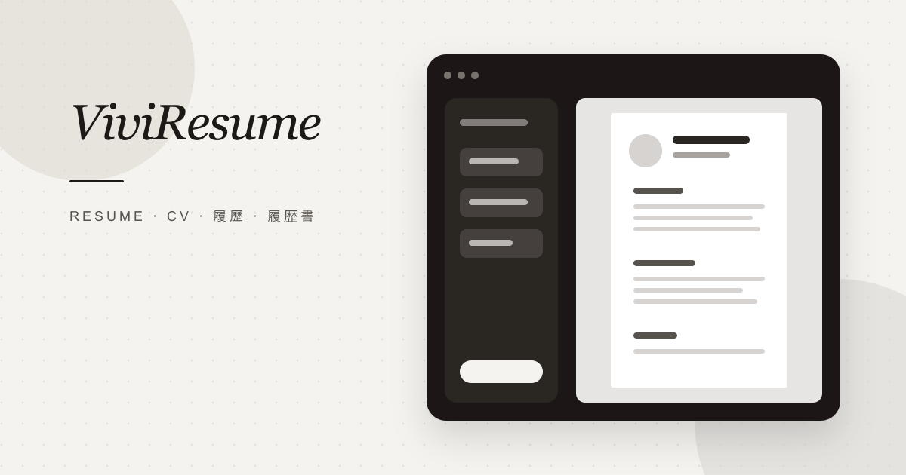

# ViviResume — Guía de uso

[English (US)](README.md) | [English (UK)](README.en-GB.md) | [Español (España)](README.es-ES.md) | [Español (México)](README.es-MX.md) | [Português (Brasil)](README.pt-BR.md) | [Français](README.fr-FR.md) | [Deutsch](README.de-DE.md) | [Italiano](README.it-IT.md)

[Nederlands](README.nl-NL.md) | [Svenska](README.sv-SE.md) | [Polski](README.pl-PL.md) | [Čeština](README.cs-CZ.md) | [Română](README.ro-RO.md) | [Türkçe](README.tr-TR.md) | [Русский](README.ru-RU.md) | [Українська](README.uk-UA.md)

[日本語](README.ja-JP.md) | [한국어](README.ko-KR.md) | [Bahasa Indonesia](README.id-ID.md) | [Tiếng Việt](README.vi-VN.md) | [ไทย](README.th-TH.md) | [हिन्दी](README.hi-IN.md) | [বাংলা](README.bn-BD.md) | [简体中文](README.zh-CN.md)

[繁體中文](README.zh-TW.md)

[Sitio web](https://viviresume.com/) · [Primeros pasos](https://viviresume.com/templates)

## Acerca de ViviResume

Elige una plantilla profesional, agrega tu experiencia y revisa el resultado en tiempo real. Conserva el borrador en este navegador o guárdalo en la nube y compártelo mediante un enlace.

## Crea tu CV en tres pasos

Elige una plantilla, agrega tu trayectoria y después guarda, comparte o descarga el resultado.

### 1. Elige una plantilla

Compara los diseños y elige la estructura y el estilo que mejor presenten tu contenido.

### 2. Agrega tu experiencia laboral

Reemplaza el contenido de ejemplo, ordena las secciones y termina de ajustar la página mientras ves la vista previa.

### 3. Guardar, compartir o descargar

Revisa la página final y guárdala en la nube, compártela mediante un enlace o descárgala como PDF, DOCX, DOC o Markdown.

## Condiciones de uso

Guardar en la nube y compartir mediante un enlace requiere iniciar sesión. Los borradores del navegador permanecen en este dispositivo.

### Secciones para cada trayectoria

Agrega experiencia laboral, estudios, proyectos, habilidades, idiomas, certificados, un perfil y secciones personalizadas. Da formato a los detalles e incluye una foto o imágenes de certificados cuando te resulte útil.

### Personaliza el diseño a detalle

Ajusta fuentes, colores, tamaño y altura de línea, márgenes, separación entre secciones, escala del contenido y ajuste automático a una página.

## Preguntas frecuentes

### ¿Puedo conservar el currículum en este navegador o guardarlo en la nube?

Sí. El borrador se guarda en este navegador mientras editas. Cuando eliges «Guardar en la nube», ViviResume crea o actualiza la versión en línea. Los cambios posteriores permanecen en el navegador hasta que vuelvas a guardarlos en la nube.

### ¿Dónde se guarda el borrador en este navegador?

El borrador se guarda en este navegador y en este dispositivo. No aparecerá en otros dispositivos y podría perderse si borras los datos del navegador. Guárdalo en la nube cuando quieras tener una versión en línea.

### ¿Quién puede ver un CV compartido?

Después de guardar el currículum en la nube, activa el enlace público. Cualquier persona que tenga el enlace podrá verlo. Puedes desactivar el enlace, generar uno nuevo y decidir si los visitantes pueden descargar el PDF.

### ¿Qué formatos de descarga están disponibles?

Puedes descargar tu currículum en PDF, DOCX, DOC o Markdown. El PDF conserva el diseño de la vista previa; los archivos de Word y Markdown te permiten seguir editando el contenido.

### ¿Qué versiones de idiomas regionales están disponibles?

ViviResume ofrece interfaces, plantillas y ejemplos adaptados a 25 versiones regionales en 22 idiomas. Cambiar el idioma de la interfaz no traduce el contenido que ya escribiste en tu currículum.

### ¿Puedo cambiar un borrador existente a otra plantilla?

Todavía no. Para usar otra plantilla, crea un borrador nuevo con esa plantilla y copia manualmente el contenido que quieras conservar. El borrador actual no se modificará.

## Ayuda

[Sitio web](https://viviresume.com/) · [Primeros pasos](https://viviresume.com/templates)
